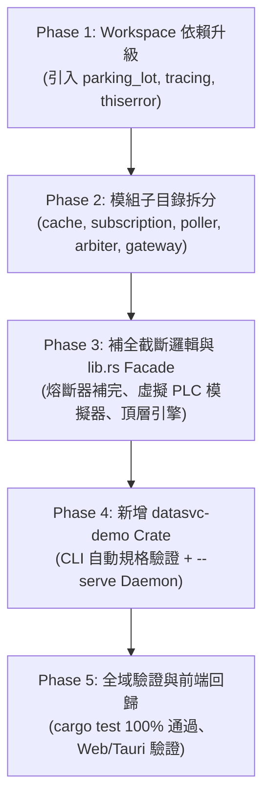

# 工業級 PLC 資料服務層 (PlcDataService) 架構升級計劃書

> **目標**：評估現有架構升級至 `dataservice1.md` 所規劃之「模組化子目錄 + `parking_lot` + `tracing` + 雙 DEMO (Web + CLI Daemon)」架構之可行性、複雜度與執行步驟。  
> **狀態**：等待用戶評估審查 (Pending Review)

---

## 1. 複雜度綜合評估 (Complexity Assessment)

整體升級複雜度評定為 **中等 (Medium Complexity)**：

* **技術難度不高**：核心演算法（智慧拼包、3 秒退訂冷卻、四大護欄、單站熔斷器）在現有專案中已經 100% 實作且通過單元測試。升級主要是「目錄結構解構」、「並發鎖與日誌庫換裝」以及「補全截斷代碼」。
* **工程工作量清晰**：預計包含 5 大模組目錄拆分、12 個子檔案重構、1 個新增 CLI Daemon Crate，預估耗時約 1~2 小時。
* **風險完全可控**：只要保持頂層 `PlcDataService` 對外的 Public API 簽名不變，現有的 `src-tauri` 與前端視覺化 DEMO 都不會遭到破壞。

---

## 2. 關鍵架構決策：避免 dataservice1 的「過度 Mock 陷阱」

在 `dataservice1.md` 的初稿中，作者為了自給自足，刻意移除了 `machine-model` 與 `mm-drivers`，自己本地重新定義了 `ScalarValue`、`ResolvedMachineModel` 與 `TagModelSpec`。

> [!WARNING] **核心架構陷阱提示**
> 若完全照搬 `dataservice1.md` 的去依賴做法，專案將**失去與 upstream 56 種工業協議驅動及 §9.3 機台模型護欄規則的連動能力**。

### 建議的「雙贏」升級策略 (Best of Both Worlds)
* **採納 `dataservice1` 的精華**：
  1. 模組化目錄拆分（`cache/`, `subscription/`, `poller/`, `arbiter/`, `gateway/`）。
  2. 升級 `parking_lot`（無鎖中毒、1-byte Mutex、自適應自旋讀取）。
  3. 升級 `tracing`（納秒級非同步時序 Span 與結構化事件）。
  4. 補齊 `crates/datasvc-demo`（終端自動化驗證與 `--serve` 無頭 Daemon）。
* **保留目前專案的優勢**：
  1. 保持與 `machine-model` 與 `mm-drivers` 的實體依賴，不降級為假 Mock。
  2. 保持 Tauri 桌面 IPC 與視覺化 Web 工作台的相容性。

---

## 3. 升級前後對比矩陣 (Before vs After)

| 比較項目 | 現有架構 (dataservice.md) | 升級後架構 (dataservice1 強化版) | 效益評估 |
| :--- | :--- | :--- | :--- |
| **原始碼結構** | 單一整合檔 `src/lib.rs` (1200+ 行) | 5 大子目錄、10+ 獨立子檔案 | 權責單一，多人協作與維護性大幅提升 |
| **執行緒鎖** | `std::sync::{Arc, RwLock}` | `parking_lot::{RwLock, Mutex}` | 徹底杜絕鎖中毒，極致微秒讀取延遲 |
| **觀測性與日誌** | 內存 `AuditLogEntry` 佇列 | `tracing` 結構化 Span + 審計日誌 | 精確量測 PLC 通訊 RTT，支援 APM/MES 對接 |
| **通訊網關** | 單純驅動 Map 儲存 | `gateway/mod.rs` 內建**高擬真虛擬 PLC 模擬器** | 無硬體環境下也能自動跑通訊測試 |
| **DEMO 形態** | Web 視覺化工作台 + Tauri IPC | **雙 DEMO**：保留 Web 工作台 + 新增 CLI Daemon | 兼顧工程師桌面調校與邊緣無螢幕閘道器部署 |
| **測試覆蓋** | 3 個整合測試 | 模組獨立單元測試 + 整合測試 + 規格逐項驗證 CLI | 測試粒度更細緻 |

---

## 4. 分階段執行計劃 (5-Phase Execution Plan)

### Phase 1: 依賴與目錄骨架建立
1. 修改根目錄與 `crates/plc-data-service/Cargo.toml`：
   - 引入 `parking_lot = "0.12"`、`tracing = "0.1"`、`tracing-subscriber = "0.3"`、`thiserror = "1.0"`、`async-trait = "0.1"`。
2. 建立目錄骨幹：
   - `crates/plc-data-service/src/cache/`
   - `crates/plc-data-service/src/subscription/`
   - `crates/plc-data-service/src/poller/`
   - `crates/plc-data-service/src/arbiter/`
   - `crates/plc-data-service/src/gateway/`

### Phase 2: 核心模組細部遷移與升級
1. **`cache/`**：
   - `snapshot.rs`: `TagSnapshot`, `DataQuality`, `TagChangeEvent`, `DeadbandConfig`。
   - `mod.rs`: `TagStore`（改用 `parking_lot::RwLock`，微秒讀取直通）。
2. **`subscription/`**：
   - `tracker.rs`: 引用計數、3 秒退訂冷卻倒數計時器、Zombie Auto-GC。
   - `events.rs`: ViewportReady 與 COS 事件通道。
   - `mod.rs`: 雙軌訂閱管理器主體。
3. **`poller/`**：
   - `coalescing.rs`: 間隙容忍相鄰拼包演算法。
   - `scheduler.rs`: 多速率時間輪佇列（High 50ms, Normal 250ms, Low 1000ms）。
   - `mod.rs`: 輪詢調度器。
4. **`arbiter/`**：
   - `guardrails.rs`: §9.3 四大寫入護欄（與 upstream `machine-model` 結合）。
   - `mod.rs`: Urgent 插隊仲裁、審計日誌。
5. **`gateway/`**：
   - `circuit_breaker.rs`: 補全 `dataservice1.md` 截斷的後半段（`should_allow_poll`, `record_success`, `record_failure`）。
   - `mod.rs`: 通訊抽象通道與**內建高擬真虛擬 PLC 模擬器**。

### Phase 3: 頂層引擎黏合 (`lib.rs`)
1. 在 `crates/plc-data-service/src/lib.rs` 組織公開匯出（Facade 模式）。
2. 保留原有的 `PlcDataService::from_resolved_model`、`write_tag`、`compute_active_coalesced_blocks` 等 API 介面。
3. 執行 `cargo test -p plc-data-service`，確保原本的 3 大整合測試全部順利通過。

### Phase 4: 新增獨立 DEMO Crate (`crates/datasvc-demo`)
1. 建立 `crates/datasvc-demo/Cargo.toml` 與 `src/main.rs`。
2. 實作功能：
   - 自動化規格檢驗（按順序印出 §1 ~ §9 各項機制運作報告）。
   - 終端互動模式（Terminal HMI）：支援鍵盤即時手動寫入與觀測點位。
   - Daemon 無頭伺服器模式（`--serve --port 8080`），支援外部連線。

### Phase 5: 全系統驗證與回歸測試
1. 執行 `cargo check --workspace` 與 `cargo test --workspace`。
2. 確保 `src-tauri` 編譯與 IPC 命令依然暢通。
3. 確保 `plc_data_service_workbench_demo.html` 正常運作。

---

## 5. 執行建議與決策建議

* **推薦執行升級**：若您希望將此專案作為未來的「工業級標準執行期核心」，重構為 `dataservice1` 的模組化架構能大幅提升專業度、維護性與並發效能。
* **風險低、代價可控**：因為我們已知所有截斷丟失的邏輯並能無縫補全，升級屬於純粹的「架構良性演進」，不會有技術死角。
